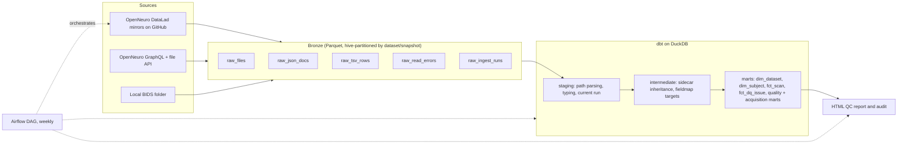

# neurolake

A small lakehouse for neuroimaging metadata. It pulls [BIDS](https://bids.neuroimaging.io) datasets from [OpenNeuro](https://openneuro.org) (or a local folder), lands them as raw Parquet, models them with dbt on DuckDB, and flags the metadata problems that break reuse.

Only metadata moves through the pipeline: file listings, `participants.tsv`, `*_scans.tsv` and JSON sidecars. Imaging data is never downloaded. From OpenNeuro's DataLad mirrors, file sizes come from git-annex keys, so a multi-terabyte dataset ingests in seconds.

## OpenNeuro audit

[**How clean is OpenNeuro's metadata?**](https://pearlfranz20.github.io/neurolake/) ([source](docs/index.html)) runs neurolake over a reproducible random sample of 150 OpenNeuro datasets (6,587 subjects, 57,382 data files, 5.6 TB described):

- 51% of raw datasets pass every rule. 7% have an error that breaks BIDS.
- Participant bookkeeping is the weak spot: 19% have no `participants.tsv`, and some tables disagree with the data folders on ID format (`sub-1` against `sub-001`, or no `sub-` prefix at all).
- 11 datasets mix TRs or sampling rates within one task, which matters for any pipeline that assumes one value per task.
- A `.bidsignore` can hide more than intended. One dataset's `*` ignores every file, and another's `**/*dat*` matches `dataset_description.json`.

Every number comes from `audit/findings.json`, produced by `audit/analyze.py`. `make audit` reruns the whole thing, and the same seed draws the same sample. The rules were checked against the BIDS schema, and the findings were verified independently against the raw files (see the method section of the page).

## Architecture



## Quick start

```bash
pip install -e ".[dev]"

neurolake demo                              # offline: synthetic fixtures -> data/report.html
neurolake ingest-mirror ds000117 ds002718   # real OpenNeuro data via the GitHub mirrors
neurolake transform && neurolake report     # build, test, report
neurolake discover-mirrors --sample 50      # a reproducible random sample of accessions
neurolake ingest-local ~/data/ds000117 --snapshot 1.1.0
make audit                                  # regenerate the OpenNeuro audit
pytest -q                                   # unit, mocked-API and end-to-end tests
make docs                                   # dbt docs site with the lineage graph
```

## What it models

**The BIDS inheritance principle.** A data file's metadata is the merge of every JSON sidecar with the same suffix that sits in its folder or a parent folder and whose entities are a subset of the file's own. `int_effective_sidecars` resolves this in SQL. Every `key-value` pair in a filename is parsed into an entity list, candidate sidecars are joined on folder ancestry and `list_has_all`, ordered from the dataset root down, and folded with `json_merge_patch` so the closest file wins. Matching uses all entities, so the two inversions of an MP2RAGE (`inv-1`, `inv-2`) each keep their own `InversionTime`. Each merged document is parsed once: some real datasets carry sidecars of several hundred KB, and repeated extraction exhausted memory.

**Subjects from both sides.** `dim_subject` is a full outer join of `participants.tsv` and the subjects that have data, with a flag for each side, so a subject missing from either stays queryable. Subjects whose data is all covered by `.bidsignore` count as having data.

**Runs and snapshots.** Each ingest stages all five bronze tables outside the read path, then swaps them into its own `(dataset_id, snapshot)` partition with `raw_ingest_runs` last, under a per-dataset lock. Every bronze row carries its `run_id`, and staging reads only rows from each dataset's latest run, so a crash halfway through publishing never mixes two runs.

**Failures.** A metadata file whose content is unusable (bad encoding, missing) is recorded in `raw_read_errors` and reported as a quality issue. Content that sits in git-annex and was not fetched is marked unknown rather than missing, and checks that depend on it are skipped. A network failure that outlasts the retries fails the run and leaves the previous data in place.

**Real-world BIDS.** `.bidsignore` is applied with gitignore semantics, but never to core files such as `dataset_description.json`. CTF (`.ds`) and MEF3 (`.mefd`) recordings are folders and count as one data file. MEGIN calibration files are not recordings. `stimuli/` is not validated. Derivative datasets only get file-integrity checks.

| Model | Grain |
| --- | --- |
| `dim_dataset` | dataset at its current snapshot |
| `dim_subject` | subject seen in `participants.tsv` or in the data |
| `fct_scan` | primary data file (NIfTI, EDF, BrainVision, FIF, CTF, SNIRF...) with resolved TR, sampling rate, scanner, `acq_time` |
| `fct_dq_issue` | one data-quality finding |
| `mart_dataset_quality` | dataset readiness: errors, warnings, share of clean files |
| `mart_acquisition_summary` | parameters per dataset, datatype and task |

## Data-quality rules

Rules live in `fct_dq_issue`, one CTE each, and are catalogued in `seeds/dq_rules.csv`. Sidecar field levels come from `seeds/required_sidecar_fields.csv`, which cites the [BIDS schema](https://github.com/bids-standard/bids-specification/tree/master/src/schema/rules/sidecars) rule behind each row. Adding a field check is a one-line seed change.

- **Participants:** no `participants.tsv`, IDs without the `sub-` prefix, duplicate IDs, subjects on only one side of the table/data join
- **Sidecars:** REQUIRED fields missing (error) and RECOMMENDED ones (warning), with alternatives such as `RepetitionTime` or `VolumeTiming`, more than one sidecar applying at one folder level
- **Acquisition:** TRs or sampling rates more than 0.5% apart within one task and acquisition, BOLD TRs that look like milliseconds
- **References:** fieldmap `IntendedFor` and `scans.tsv` entries pointing at files that do not exist
- **Files:** invalid JSON, malformed TSV rows, unreadable files, subject folders not at the root, a missing or incomplete `dataset_description.json`, `.bidsignore` patterns that match core files or every data file

## Testing

- **dbt:** every build runs schema tests (keys, relationships, accepted values), two singular tests and three dbt unit tests covering path parsing with stale-run filtering, sidecar override order with entity matching, and same-level ambiguity. Data defects become issue rows, never test failures, so one messy dataset cannot block the rest.
- **pytest:** TSV parsing, idempotent re-ingest, read errors recorded versus outages failing the run, the OpenNeuro API client against a mock, and an end-to-end run over synthetic datasets. That run asserts that every injected defect is detected and that each real-world false positive found during the audit (`MUST_NOT_FLAG` in `neurolake/fixtures.py`) stays quiet.
- **CI:** lint, tests and a demo run on Python 3.11 and 3.13, the QC report uploaded as a build artifact, and an Airflow 3 job that checks the DAG imports.

## Orchestration

`dags/neurolake_openneuro.py` runs weekly: one dynamically mapped ingest task per dataset (at most 4 in parallel) from the GitHub mirrors, then `dbt build`, then the report. The dataset list is a DAG param, de-duplicated so two tasks never ingest the same dataset. It uses the Airflow 3 `airflow.sdk` API and falls back to the 2.x imports. `make airflow` starts a local standalone instance.

## Limits

- The OpenNeuro API client (`ingest-openneuro`) follows the documented GraphQL API and is tested against a mock only. The GitHub mirror source is the one exercised on real data.
- `participants.tsv` columns vary. The model extracts the BIDS-recommended ones (age, sex, handedness, group) and keeps the full row as JSON.
- `IntendedFor` URIs into other datasets (`bids:<name>:...`) are recorded but not checked.
- The per-dataset lock uses `fcntl`, so ingest runs on Linux and macOS.
- This complements the official [bids-validator](https://github.com/bids-standard/bids-validator) rather than replacing it. It covers the problems that most often break pooled analyses, and makes them queryable across many datasets at once.
