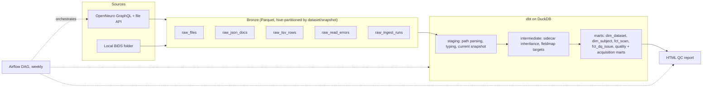

# neurolake

A small lakehouse for neuroimaging metadata. It pulls [BIDS](https://bids.neuroimaging.io) datasets from [OpenNeuro](https://openneuro.org) (or a local folder), lands them as raw Parquet, models them with dbt on DuckDB, and produces a data-quality report that tells you whether a dataset is ready to analyse.

Only metadata moves through the pipeline: file listings, `participants.tsv`, `*_scans.tsv` and JSON sidecars. Imaging payloads are listed with their sizes and never downloaded, so a 200 GB dataset ingests in seconds.



## Quick start

```bash
pip install -e ".[dev]"

neurolake demo                        # offline: synthetic fixtures -> report in data/report.html
make openneuro                        # real data: ds000001, ds000117, ds002718
neurolake ingest-openneuro ds000248   # any public accession, latest snapshot
neurolake ingest-local ~/data/ds000117 --snapshot 1.1.0
pytest -q                             # unit, mocked-API and end-to-end tests
make docs                             # dbt docs site with the lineage graph
```

## What it models

**The BIDS inheritance principle.** A data file's metadata is the merge of every JSON sidecar with the same suffix that sits in its folder or any parent folder and whose entities are a subset of the file's own. `int_effective_sidecars` resolves this in SQL. Every `key-value` pair in a filename is parsed into an entity list, candidate sidecars are joined on folder ancestry and `list_has_all`, ordered from the dataset root down, and folded with `json_merge_patch` so the closest, most specific file wins. Matching uses all entities, so the two inversions of an MP2RAGE (`inv-1`, `inv-2`) each keep their own `InversionTime`. This is where acquisition mismatches hide, because a top-level `task-nback_bold.json` can say `RepetitionTime: 2.0` while one run overrides it to `1.5`.

**Subjects from both sides.** `dim_subject` is a full outer join of `participants.tsv` and the subjects that actually have data, with flags for each side, so a subject missing from either one stays queryable instead of being dropped.

**Runs and snapshots.** Each ingest stages all five bronze tables outside the read path, then swaps them into its own `(dataset_id, snapshot)` partition with `raw_ingest_runs` last, under a per-dataset lock. Every bronze row carries its `run_id`, and staging reads only rows from each dataset's latest run, so a crash halfway through publishing can never mix two runs. Re-runs and Airflow retries are idempotent, and a singular test asserts the marts never mix snapshots.

**Failures.** A metadata file whose content is unusable (bad encoding, 404, unfetched annex content) is recorded in `raw_read_errors` and reported as a quality issue. A network or API failure that outlasts the retries fails the run and leaves the previous data in place, so Airflow can retry it.

**Folder formats.** CTF MEG (`.ds`) and MEF3 iEEG (`.mefd`) recordings are folders. Each one is collapsed into a single data file whose size is the sum of its contents.

| Model | Grain |
| --- | --- |
| `dim_dataset` | dataset at its current snapshot |
| `dim_subject` | subject seen in `participants.tsv` or in the data |
| `fct_scan` | primary data file (NIfTI, EDF, BrainVision, FIF, CTF, SNIRF...) with resolved TR, sampling rate, scanner, `acq_time` |
| `fct_dq_issue` | one data-quality finding |
| `mart_dataset_quality` | dataset readiness: errors, warnings, share of clean files |
| `mart_acquisition_summary` | parameters per dataset, datatype and task |

## Data-quality rules

Rules live in `fct_dq_issue`, one CTE each, and are catalogued in `seeds/dq_rules.csv`. Required sidecar fields per datatype come from `seeds/required_sidecar_fields.csv`, so adding a check for a new modality is a one-line seed change.

- subject has data but no `participants.tsv` row, or the reverse
- BOLD runs of one task and acquisition with different `RepetitionTime`
- EEG/MEG/iEEG recordings of one task and acquisition with different `SamplingFrequency`
- required sidecar fields not set by any applicable sidecar
- more than one sidecar applying at the same folder level
- fieldmap `IntendedFor` pointing at a file that does not exist (BIDS URIs and the older subject-relative form)
- invalid JSON, malformed TSV rows, unreadable metadata files (JSON or TSV)
- `dataset_description.json` missing or without `Name` / `BIDSVersion`
- `scans.tsv` rows referencing missing files, data files with unknown size

## Testing

- **dbt:** every build runs schema tests (keys, relationships, accepted values, value ranges), two singular tests and three dbt unit tests: BIDS path parsing with stale-run filtering, sidecar override order with entity matching, and same-level ambiguity.
- **pytest:** TSV parsing edge cases, idempotent re-ingest, read errors recorded versus outages failing the run, the OpenNeuro client against a mocked API (tree walk, retries on 429 and 5xx with `Retry-After`, path mapping, 404 handling, GraphQL errors), and an end-to-end run that asserts every defect injected by `neurolake.fixtures` is detected, nothing else raises an error, and MP2RAGE and CTF data resolve correctly.
- **CI:** lint, tests and a demo run on Python 3.11 and 3.13, the QC report uploaded as a build artifact, and an Airflow 3 job that checks the DAG imports.

Reversing the inheritance order in `int_effective_sidecars` fails the build, which is the kind of regression the suite is meant to catch.

## Orchestration

`dags/neurolake_openneuro.py` runs weekly: one dynamically mapped ingest task per dataset (capped at 4 in parallel), then `dbt build`, then the report. The dataset list is a DAG param, de-duplicated so two tasks never ingest the same dataset, and a manual run can target any accessions. It uses the Airflow 3 `airflow.sdk` API and falls back to the 2.x imports. `make airflow` starts a local standalone instance.

## Status and limits

- The OpenNeuro client follows the documented GraphQL API (`snapshot.files(tree:)`) and is tested against a mock. It walks the tree one folder per request, which is simple and reliable but slow for datasets with thousands of subjects.
- `participants.tsv` columns vary between datasets. The model extracts the BIDS-recommended ones (age, sex, handedness, group) and keeps the full row as JSON.
- Derivatives, `sourcedata/` and `code/` are skipped. They are separate BIDS datasets with their own rules.
- `IntendedFor` URIs into other datasets (`bids:<name>:...`) are recorded but not checked.
- The per-dataset lock uses `fcntl`, so ingest runs on Linux and macOS.
- This is not a replacement for the official [bids-validator](https://github.com/bids-standard/bids-validator). It covers the metadata problems that most often break pooled analyses and makes them queryable across many datasets at once.
